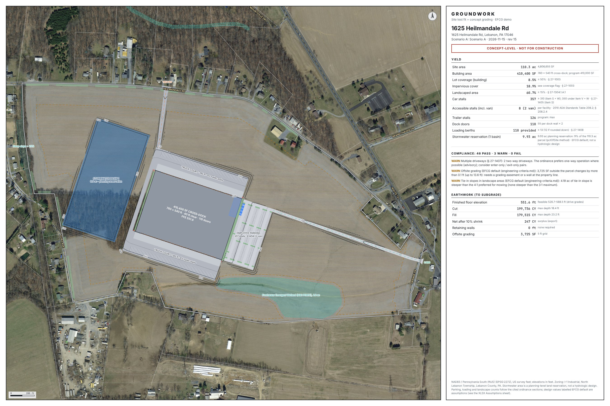

# Groundwork

**AI-driven industrial site test fit + concept grading.** An internal EFCG demo, not a commercial product.
Concept-level, not for construction.

Groundwork is a browser-based, Civil 3D-flavored tool for warehouse / industrial land development. It loads a site
(parcel, roads, terrain, constraints, zoning), turns the zoning ordinance into cited rules and envelopes, generates a
test fit (building, truck courts, trailer and car parking, separated truck/car circulation, stormwater reservation),
grades it (pad, dock-height courts, parking planes, drives, basin, 3:1 tie-ins), computes cut/fill and balances the
earthwork by optimizing the finished floor elevation.

Every action is a **command**. Type what you want in the **Chat** panel on the right of the app, or connect Claude
Desktop / Claude Code through the local **MCP server**, and say:

> Fit a 410,000 SF cross-dock with the long side parallel to Heilmandale Rd. Trucks come in from Heilmandale Rd,
> employee cars only from Orange Lane, and don't connect truck and car circulation.

Claude decides and explains; the deterministic engine does the geometry and the math. The app never calls the
Anthropic API and needs no API key: the chat panel runs Claude through Claude Code on your computer when it is
installed, and falls back to a simple built-in parser when it is not (see [`docs/CHAT.md`](docs/CHAT.md)).

The demo site is real: the county tax parcel, an aerial photo registered to it, USGS LiDAR terrain, NWI wetlands and
zoning districts digitized from the township map, all cached in the repository so the app runs offline.



## 5-minute quickstart

Requirements: Node 20+ and npm. Run everything from this `groundwork` folder.

```bash
npm ci
```

```bash
npx playwright install chromium
```

(Chromium is used for `render_view`, the 24 × 36 sheet export and the end-to-end tests. Skip it and everything else
still works, including **Export ▾ → Plan image PNG**, which is drawn in your browser.)

```bash
npm run dev
```

Open <http://localhost:4310>. Click **Load demo site**, then either type in the **Chat** tab ("Fit a 410,000 SF
cross-dock parallel to Heilmandale Rd with 350 parking spaces, trucks from Heilmandale Rd and cars only from Orange
Ln"), click **▶ Demo** to watch the headline scenario replay, or drive it yourself:

- **Layers** (left): aerial photo before construction, the latest aerial (the facility as built), property boundary,
  neighbouring lots, zoning districts, wetlands, LiDAR contours.

- **Program** tab → *Generate layout*; drag the building, its handles, or a driveway.
- **Earthwork** tab → *Optimize FFE (balance)*; press `C` for the cut/fill map, `S` to cut a section, `3` for 3D.
- **Export ▾** for a PNG of the plan (saved to your Downloads folder), DXF, GeoJSON, XLSX and a 24 × 36 plan sheet. Press `?` for shortcuts.
- The command line at the bottom runs any command, e.g. `generate_layout alignToRoad="Route 72"`.
- Layer **WB-67 swept path** shows the tractor-trailer envelope along the truck drives.

To drive it from Claude, build once and register the MCP server (full steps in [`docs/MCP_SETUP.md`](docs/MCP_SETUP.md)):

```bash
npm run build
```

```bash
claude mcp add groundwork -- node "$(pwd)/packages/mcp/dist/index.js"
```

Then follow the scripted demo in [`docs/DEMO.md`](docs/DEMO.md).

## The demo site and its data

**1625 Heilmandale Rd, North Lebanon Township, Lebanon County, PA** (I-1 Industrial): the ~110 ac tract where a
411,840 SF distribution center was built in 2020–2021.

The data in `data/sites/heilmandale/` is real public GIS data, fetched once and cached so the app runs offline. Click
the green badge at the top of the plan (or "where the site data comes from" under the chat box) for the source of
every layer.

| Layer | Source | Notes |
|---|---|---|
| Parcel | Lebanon County GIS tax parcels | 110.35 ac, matched by address. A 2017 snapshot: the tract before development. Tax-map linework, not a survey. Owner fields are not downloaded. |
| Roads | Lebanon County GIS road centerlines | Right-of-way widths are class defaults (assumed). OpenStreetMap is tried first; it was unreachable when the fixture was built. |
| Terrain | USGS 3DEP LiDAR elevation, 5 ft cells | Reviewed as pre-construction ground. |
| Wetlands | USFWS National Wetlands Inventory | One 4.8 ac wetland on the south side. Planning-level mapping, not a delineation. |
| Aerials | PEMA 2018–2020 orthoimagery (PASDA) and USGS NAIP | Exported in the site's coordinate system, so they line up with the parcel. The first shows farm fields; the second shows the facility as built. |
| Zoning districts | North Lebanon Township Zoning Map (2023), digitized | Approximate (about ±10 ft). See `scripts/digitize-zoning-map.py`. |
| Neighbouring lots | Lebanon County GIS tax parcels | Outlines only, for context. |
| Floodplain | FEMA NFHL | **Not loaded**: the FEMA service timed out. Check the FEMA map separately. |
| Zoning rules | `docs/reference/zoning-north-lebanon-I1.md` | Extracts of Chapter 27, not the official eCode360 text. |

Along Heilmandale Rd the lot is deeded to the road centerline, so front yards and parking setbacks are measured from
the right-of-way line (assumed 30 ft inside the lot line), not from the lot line itself.

To refresh the data on a machine with internet access:

```bash
npm run fetch-site-data
```

Each source is tried once and the per-layer result is printed and written to `provenance.json`. If the parcel or the
terrain cannot be fetched, the existing fixture is left untouched. `-- --no-imagery` keeps the cached aerials.
`data/sites/synthetic/` holds a generated test site used only by the regression tests (`npm run make-synthetic`).

## Scripts

| Command | What it does |
|---|---|
| `npm run dev` | App with hot reload on <http://localhost:4310> (one process: API + WebSocket + Vite) |
| `npm run build` | Builds the web app, the server bundle and the MCP server (`packages/mcp/dist/index.js`) |
| `npm start` | Runs the built server (no hot reload) |
| `npm run verify` | Typecheck, lint, unit tests, build, browser e2e, MCP e2e, screenshot capture to `docs/screens/` |
| `npm test` | Unit tests only (includes the hand-calc tests) |
| `npm run test:e2e` / `npm run test:mcp` | Browser tests / MCP client test (they build first) |
| `npm run demo` | Runs the headline scenario through commands; writes `docs/demo-summary.md` + `docs/screens/demo-*.png` |
| `npm run screens` | Re-captures the QA screenshots (needs `npm run build`) |
| `npm run fetch-site-data` / `npm run make-synthetic` | Refresh the real site data / regenerate the synthetic test site |

Server flags: `npm run dev -- --port 4400 --fresh` (`--fresh` ignores the saved project in `projects/`).

## Layout of the repo

```
packages/core     Pure TypeScript engines: geometry, zoning, layout, grading, checks, exports, THE command layer
packages/data     Fixture loader, synthetic fixture, live adapters (Node only)
packages/server   Express + WebSocket; owns project state; POST /api/commands/:name
packages/mcp      MCP server (stdio); each tool forwards one command to the server
packages/web      React + Canvas plan view + Three.js 3D view + panels
data/sites        Cached site fixtures (the app never needs the network)
docs              reference/ (inputs), screens/ (QA screenshots), DEMO, MCP_SETUP, ARCHITECTURE, LIMITATIONS
scripts, e2e      Data scripts, demo script, screenshot capture, end-to-end tests
```

More in [`docs/ARCHITECTURE.md`](docs/ARCHITECTURE.md). Decisions made during the build are in [`DECISIONS.md`](DECISIONS.md);
status is in [`PROGRESS.md`](PROGRESS.md).

## Engineering basis

- Zoning: North Lebanon Township Chapter 27 (I-1), as extracted in `docs/reference/zoning-north-lebanon-I1.md`; every
  rule carries its section number and shows in the Zoning tab with its interpretation flags.
- Design defaults and grading criteria: `docs/reference/engineering-criteria.md`, implemented in
  `packages/core/src/criteria/` with a source comment on every value and listed in the Assumptions (Zoning tab, XLSX).
- Hand calculations T1–T13 from the criteria document are unit tests (`npm test`).
- Accessible parking: 2010 ADA Standards Table 208.2, § 208.2.4, § 502.4.

This is a planning tool. It does not produce construction documents, pipe networks, structural design, stormwater
routing or permit plans.
