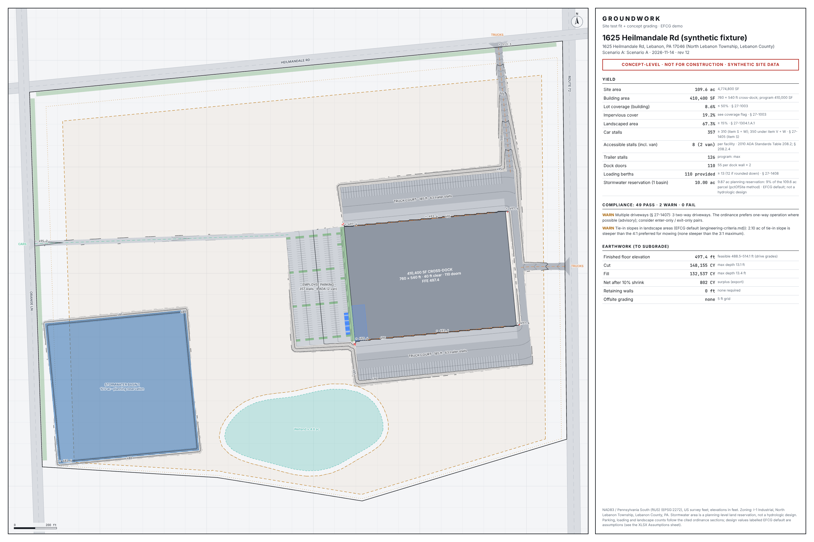

# Groundwork

**AI-driven industrial site test fit + concept grading.** An internal EFCG demo, not a commercial product.
Concept-level, not for construction.

Groundwork is a browser-based, Civil 3D-flavored tool for warehouse / industrial land development. It loads a site
(parcel, roads, terrain, constraints, zoning), turns the zoning ordinance into cited rules and envelopes, generates a
test fit (building, truck courts, trailer and car parking, separated truck/car circulation, stormwater reservation),
grades it (pad, dock-height courts, parking planes, drives, basin, 3:1 tie-ins), computes cut/fill and balances the
earthwork by optimizing the finished floor elevation.

Every action is a **command**. A local **MCP server** exposes the same commands to Claude Desktop / Claude Code, so
you can sit beside the browser and say:

> Fit a 410,000 SF cross-dock with the long side parallel to Heilmandale Rd. Trucks come in from Route 72 and
> Heilmandale Rd, employee cars only from Orange Lane, and don't connect truck and car circulation. Then grade it and
> balance the earthwork.

Claude decides and explains; the deterministic engine does the geometry and the math. The app never calls the
Anthropic API and needs no API key.



## 5-minute quickstart

Requirements: Node 20+ and npm. Run everything from this `groundwork` folder.

```bash
npm ci
```

```bash
npx playwright install chromium
```

(Chromium is used for `render_view`, the PNG sheet export and the end-to-end tests. Skip it and everything else still works.)

```bash
npm run dev
```

Open <http://localhost:4310>. Click **Load demo site**, then **▶ Demo** to watch the headline scenario replay, or
drive it yourself:

- **Program** tab → *Generate layout*; drag the building, its handles, or a driveway.
- **Earthwork** tab → *Optimize FFE (balance)*; press `C` for the cut/fill map, `S` to cut a section, `3` for 3D.
- **Export ▾** for DXF, GeoJSON, XLSX and a 24 × 36 plan sheet. Press `?` for shortcuts.
- The command line at the bottom runs any command, e.g. `generate_layout alignToRoad="Route 72"`.
- Layer **WB-67 swept path** shows the tractor-trailer envelope along the truck drives.

To drive it from Claude, build once and register the MCP server (full steps in [`docs/MCP_SETUP.md`](docs/MCP_SETUP.md)):

```bash
npm run build
```

```bash
claude mcp add groundwork -- node "$(pwd)/packages/mcp/dist/index.js"
```

Then follow the scripted demo in [`docs/DEMO.md`](docs/DEMO.md).

## The demo site and its data

**1625 Heilmandale Rd, North Lebanon Township, Lebanon County, PA** (I-1 Industrial): the ~110 ac tract where a
411,840 SF distribution center was built in 2020–2021.

> **The committed fixture is SYNTHETIC.** This repository was built in a sandbox whose network policy blocked every
> data host (PASDA, USGS, OSM, FEMA, USFWS, eCode360). Per the fallback chain in the spec, `data/sites/heilmandale/`
> holds a generated ~110 ac parcel, guessed road layout, district polygons from the 2020 Planning Commission minutes,
> a ~5 ac wetland and a generated terrain with ~45 ft of relief. The UI shows a persistent **SYNTHETIC** badge and every
> export says so. Zoning values and section numbers are real extracts from `docs/reference/zoning-north-lebanon-I1.md`.

To replace it with live data on a machine with internet access:

```bash
npm run fetch-site-data
```

This tries each source once (census geocoder → PASDA parcels → OpenStreetMap roads and as-built footprint → USGS 3DEP
terrain → NWI wetlands → FEMA flood zones → USGS imagery tiles), writes `data/sites/heilmandale/` with
`provenance.json`, and prints a per-layer report. It was **not** exercised against the live services (see
[`docs/LIMITATIONS.md`](docs/LIMITATIONS.md)); if the parcel or the DEM cannot be fetched it leaves the fixture untouched.
`npm run make-synthetic` regenerates the synthetic fixture.

## Scripts

| Command | What it does |
|---|---|
| `npm run dev` | App with hot reload on <http://localhost:4310> (one process: API + WebSocket + Vite) |
| `npm run build` | Builds the web app, the server bundle and the MCP server (`packages/mcp/dist/index.js`) |
| `npm start` | Runs the built server (no hot reload) |
| `npm run verify` | Typecheck, lint, unit tests, build, browser e2e, MCP e2e, screenshot capture to `docs/screens/` |
| `npm test` | Unit tests only (includes the hand-calc tests) |
| `npm run test:e2e` / `npm run test:mcp` | Browser tests / MCP client test (they build first) |
| `npm run demo` | Runs the headline scenario through commands; writes `docs/demo-summary.md` + `docs/screens/demo-*.png` |
| `npm run screens` | Re-captures the QA screenshots (needs `npm run build`) |
| `npm run fetch-site-data` / `npm run make-synthetic` | Live data fetch / synthetic fixture |

Server flags: `npm run dev -- --port 4400 --fresh` (`--fresh` ignores the saved project in `projects/`).

## Layout of the repo

```
packages/core     Pure TypeScript engines: geometry, zoning, layout, grading, checks, exports, THE command layer
packages/data     Fixture loader, synthetic fixture, live adapters (Node only)
packages/server   Express + WebSocket; owns project state; POST /api/commands/:name
packages/mcp      MCP server (stdio); each tool forwards one command to the server
packages/web      React + Canvas plan view + Three.js 3D view + panels
data/sites        Cached site fixtures (the app never needs the network)
docs              reference/ (inputs), screens/ (QA screenshots), DEMO, MCP_SETUP, ARCHITECTURE, LIMITATIONS
scripts, e2e      Data scripts, demo script, screenshot capture, end-to-end tests
```

More in [`docs/ARCHITECTURE.md`](docs/ARCHITECTURE.md). Decisions made during the build are in [`DECISIONS.md`](DECISIONS.md);
status is in [`PROGRESS.md`](PROGRESS.md).

## Engineering basis

- Zoning: North Lebanon Township Chapter 27 (I-1), as extracted in `docs/reference/zoning-north-lebanon-I1.md`; every
  rule carries its section number and shows in the Zoning tab with its interpretation flags.
- Design defaults and grading criteria: `docs/reference/engineering-criteria.md`, implemented in
  `packages/core/src/criteria/` with a source comment on every value and listed in the Assumptions (Zoning tab, XLSX).
- Hand calculations T1–T13 from the criteria document are unit tests (`npm test`).
- Accessible parking: 2010 ADA Standards Table 208.2, § 208.2.4, § 502.4.

This is a planning tool. It does not produce construction documents, pipe networks, structural design, stormwater
routing or permit plans.
